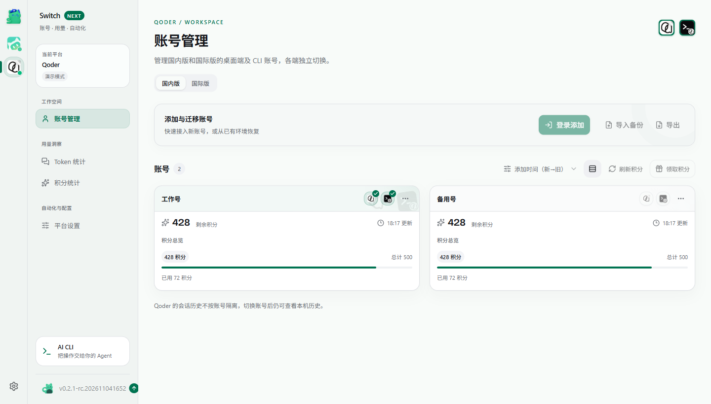
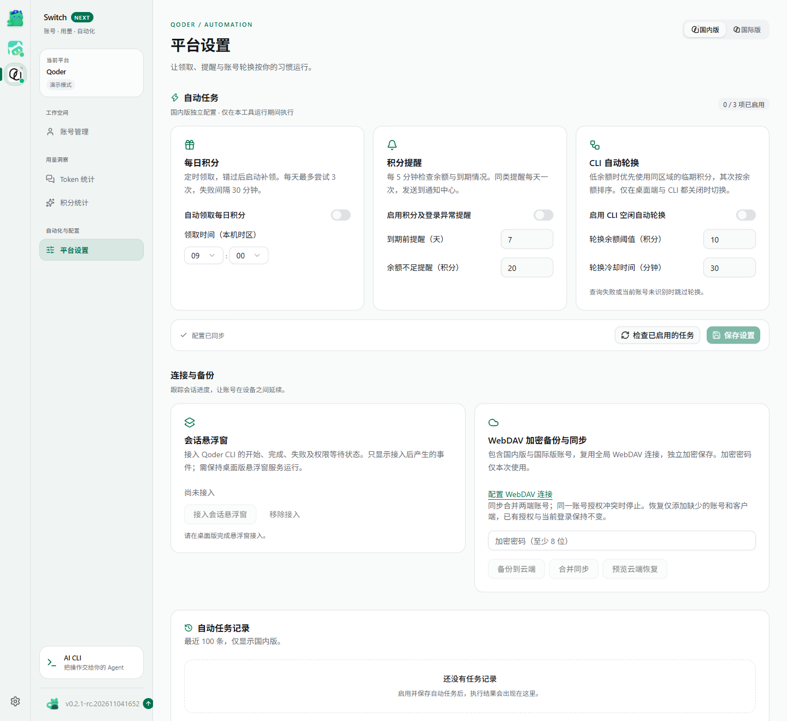
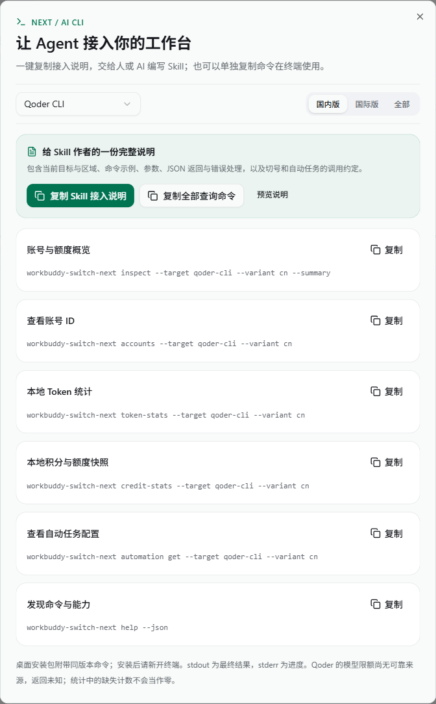
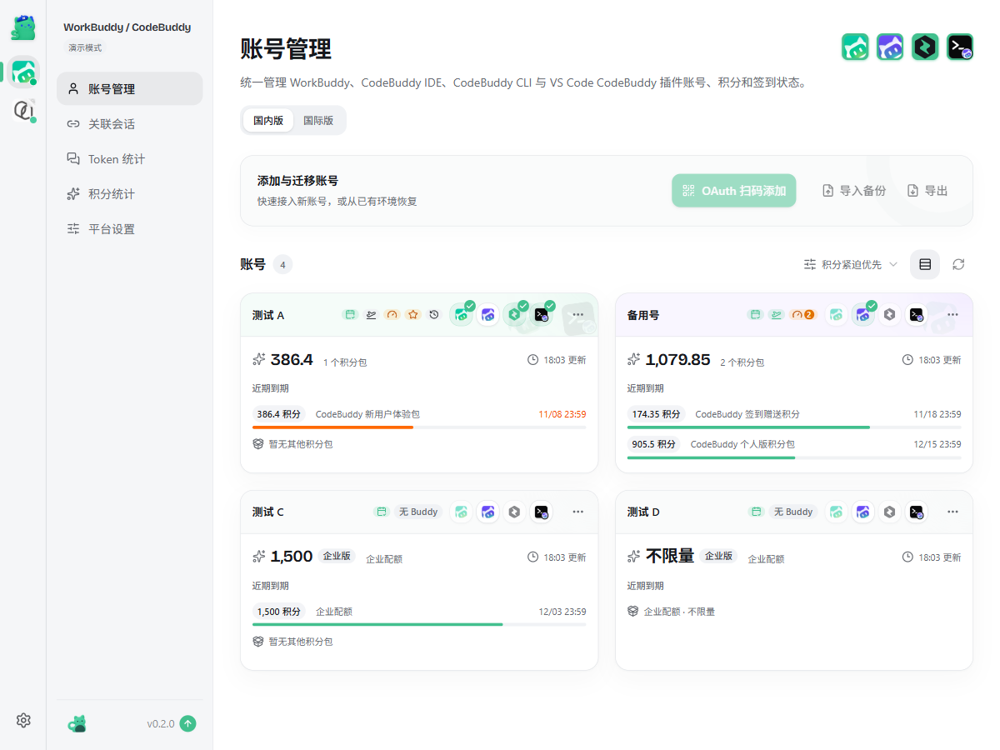
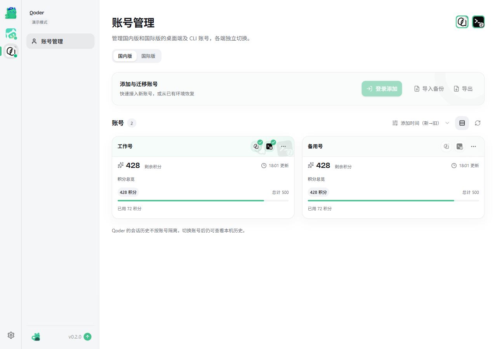
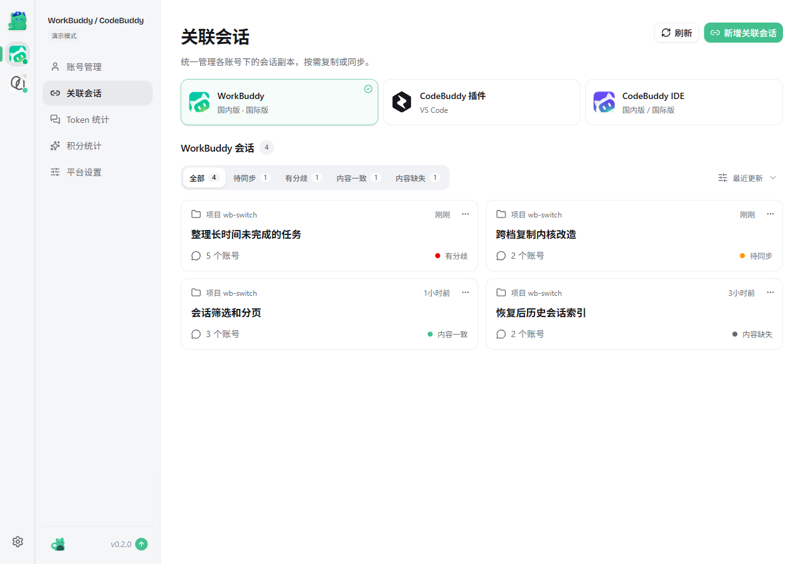
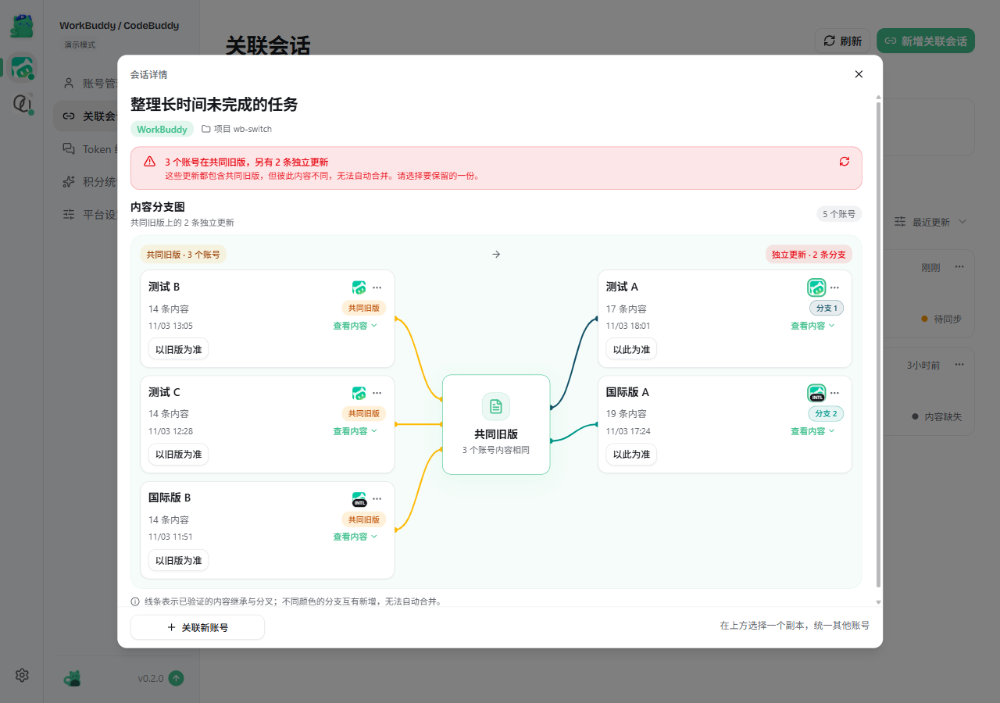
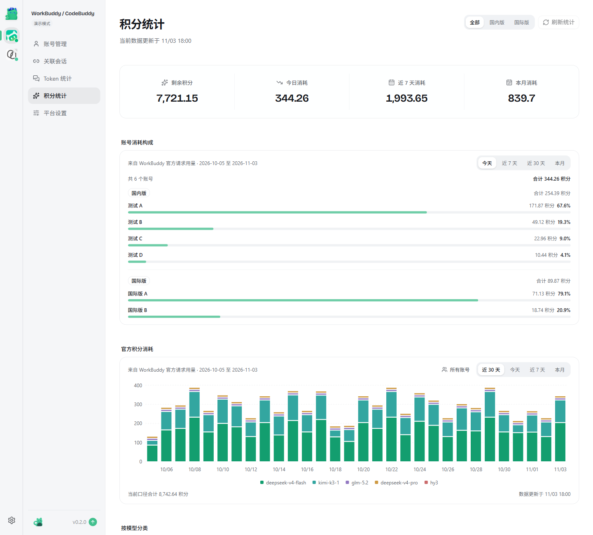
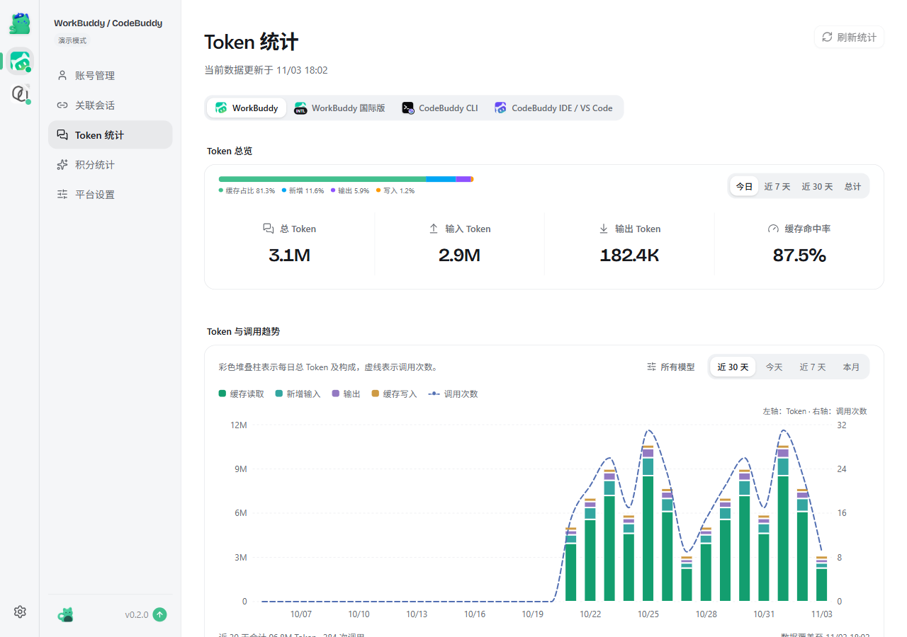

# WorkBuddy Switch Next

**多平台 AI 账号工作台。账号、用量、自动化，在一个地方管理。**

WorkBuddy Switch Next 面向同时使用多个 AI 编程客户端的人：集中管理 WorkBuddy / CodeBuddy 与 Qoder 国内版、国际版账号，查看积分与 Token 用量，安排领取和空闲轮换，也让 AI Agent 通过 CLI 读取状态、查询额度和切换账号。

桌面 App 基于 Tauri，另提供浏览器 webui 与一次性 CLI。平台各自管理账号和自动任务，共用一套导航、统计视图与操作习惯。

<p align="center">
  
</p>

[下载正式版](https://github.com/coderDJing/workbuddy-switch-next/releases/latest) · [RC 候选版](https://github.com/coderDJing/workbuddy-switch-next/releases/tag/preview) · [在线演示](https://coderdjing.github.io/workbuddy-switch-next/) · [AI CLI 文档](docs/cli.md)

## Next 的重点

Next 在上游项目的基础上，持续完善多平台工作台与 Agent 调用体验。我们重点维护以下使用路径：

| 你想做的事 | Next 的做法 |
| --- | --- |
| 管理多个 AI 工具的账号 | WorkBuddy / CodeBuddy 与 Qoder 平级切换；平台内分国内版、国际版，客户端状态与当前账号集中展示 |
| 判断剩余积分怎么用 | 查看余额、临期资源与用量趋势；Qoder 的本地请求积分和额度快照分开展示，缺失 Token 明确标记不可用 |
| 把重复操作交给工具 | 按平台设置每日领取、余额提醒和 CLI 空闲轮换；查询失败、客户端运行中等情况明确记录 |
| 让 AI Agent 帮忙管理 | 一次性 CLI 提供 JSON、能力发现、稳定账号 ID、区域筛选、汇总查询与明确错误码；界面内可一键复制 Skill 接入说明或查询命令 |
| 切号后继续工作 | WorkBuddy / CodeBuddy 支持会话复制、跨账号关联与增量同步；悬浮窗集中查看任务状态，Qoder CLI 可通过 Hooks 接入 |
| 跨设备延续配置与账号 | 加密 WebDAV 备份与同步，Qoder 使用独立备份；正式版与 RC 更新通道隔离 |

这些能力以各平台实际支持范围为准，详见 [支持的工具](#支持的工具) 与 [Qoder 说明](#qoder-国内版--国际版)。项目的维护计划、验证方式与发布记录见 [维护说明](docs/FORK-MAINTENANCE.md)。



截图与在线演示使用虚构账号、积分和请求记录；演示禁用业务写入操作。截图展示当前源码，在线演示以最近一次部署为准。

## 快速开始

日常使用推荐 [最新正式版](https://github.com/coderDJing/workbuddy-switch-next/releases/latest)。本轮正式版本为 **0.2.2**，变化与兼容说明见 [版本说明](docs/releases/0.2.2.md)；版本与安装包以 Releases 实际产物为准。需要提前体验后续变化时，可使用 [RC 候选版](https://github.com/coderDJing/workbuddy-switch-next/releases/tag/preview)。也可按 [构建说明](docs/cli.md#构建与维护) 从源码构建。

当前源码为 **0.2.3-rc.202611090934**，更新 WorkBuddy 每日任务组件并优化任务状态识别，支持 Windows x64 与 macOS Apple Silicon（arm64）。具体变化见 [候选版说明](docs/releases/0.2.3-rc.202611090934.md)，安装包与远端验证结果以对应 Release 和 GitHub Actions 实际产物为准。

前往 [正式版 Releases](https://github.com/coderDJing/workbuddy-switch-next/releases/latest) 下载对应平台的安装包：

| 平台 | 安装包 | 安装方式 |
| --- | --- | --- |
| macOS Apple Silicon（M 系列，arm64） | `workbuddy-switch-next-macos-aarch64.dmg` | 打开 DMG，将 `WorkBuddy Switch Next.app` 拖入「应用程序」 |
| Windows x64 | `workbuddy-switch-next-windows-x86_64-setup.exe` | 运行安装程序并按提示完成安装 |

正式版只接收正式版更新，RC 只通过 `preview` 接收 RC 更新。已安装 RC 的用户如需转正式版，请退出应用后手动安装正式版，无需删除 `~/.wb-switch` 账号库。安装包与独立 CLI 可用同一 Release 中的 `SHA256SUMS` 核对完整性。

macOS 首次启动若提示无法验证开发者，先在 Finder 中按住 Control 点击应用并选择「打开」，或前往「系统设置 → 隐私与安全性」选择「仍要打开」。仅当安装包来自上述官方 Releases、且系统仍提示「已损坏」时，再执行：

```bash
xattr -rd com.apple.quarantine "/Applications/WorkBuddy Switch Next.app"
```

应用能启动但切换账号时提示无权限，请参阅下方 [macOS 权限说明](#macos-权限说明)。

也可通过 CLI 启动本地 webui，在浏览器中使用，见文末 [CLI 与 webui](#cli-与-webui)。

## 功能

以下是具体能力清单；日常入口按「工作空间」「用量洞察」「自动化与配置」组织，侧栏底部提供 AI CLI 调用指南。

| 模块 | 说明 |
| --- | --- |
| 账号管理 | OAuth 扫码登录、导入导出账号、删除账号 |
| Qoder 账号管理 | 独立管理国内版 / 国际版桌面端与 CLI 账号，支持网页登录添加、本机识别、积分查询及备份迁移；验证范围见下文 |
| 账号切换 | 一键切换 WorkBuddy 登录账号，切换过程实时显示进度 |
| 会话复制 | 把当前账号勾选的会话复制给目标账号，源账号数据不受影响 |
| 关联会话 | 复制过的会话自动建立跨账号关联；按客户端集中查看同一会话在各账号中的副本状态，支持增量同步、分歧处理与新增 / 解除关联 |
| 积分到期查询 | 自动查询每个账号的积分剩余量与到期时间；7 天内到期高亮，并按紧迫程度排序、标注「建议优先使用」 |
| 积分统计 | WorkBuddy / CodeBuddy 汇总官方请求用量；Qoder 分别展示本地请求积分与账号额度快照的观察消耗，支持趋势、模型排行及请求明细 |
| Token 统计 | 按来源查看 Token 总览与趋势，含构成占比、活跃热力图、项目/模型 Top 10 与会话排行；Qoder 缺失或全零占位计数明确显示不可用 |
| CodeBuddy CLI | 与 WorkBuddy 复用同一账号库，默认账号独立；切换后立即生效，无需重启 CLI |
| CodeBuddy IDE | 支持切换 CodeBuddy IDE 桌面客户端账号，并可在弹窗中勾选复制会话，与 CodeBuddy CLI 相互独立 |
| VS Code CodeBuddy 插件 | 支持切换 VS Code 内的 CodeBuddy 插件账号；VS Code 运行时可自动关闭并在写入后重新打开 |
| JetBrains IDE 插件 | 支持切换 JetBrains 全家桶（IDEA / PyCharm / WebStorm / PhpStorm / GoLand / CLion / RubyMine / DataGrip / Rider / Aqua / DataSpell / MPS 等）与 Android Studio 内的 CodeBuddy 插件账号，一次切换写入所有装了插件的 IDE；IDE 运行时可自动关闭并在写入后重新打开 |
| 插件会话复制 | 切换插件账号时，可把当前插件账号的会话复制给目标账号（加法，源账号不变） |
| 每日领取与提醒 | 支持手动领取及平台自动任务；Qoder 国内版 / 国际版独立配置每日领取、低余额、到期及查询异常提醒 |
| 自动轮换 | CodeBuddy CLI 按积分紧迫程度轮换；Qoder CLI 按区域、余额阈值与到期顺序轮换，检测到对应区域桌面端或 CLI 运行时跳过 |
| WebDAV 备份 / 跨设备同步 | 把完整账号库（含 token 等授权信息）与各功能配置端到端加密备份到私有 WebDAV 服务器；新设备配置同一服务器与加密密码即可恢复；「同步」拉取合并 + 整库回推（同 UID 和客户端类型匹配，仅接受明确更新的凭据，冲突提示；ETag 防并发覆盖） |
| 自动更新 | 从 GitHub Releases 检查新版本，整包更新经签名校验 |
| 会话悬浮窗 | 桌面版内置 Agent Companion 悬浮栏，集中显示 Codex / WorkBuddy / CodeBuddy / Codeg 会话状态，也支持接入 Qoder 国内版 / 国际版 CLI Hooks；支持跳转的来源可点击回到原会话 |
| AI CLI | CodeBuddy CLI 与 Qoder 共用 JSON 输出、能力发现、稳定账号 ID 和错误约定；Qoder 另支持 Token / 积分统计、每日领取及自动任务管理，详见下方调用示例 |
| 权限检测 | macOS 授权引导（App 管理 / 完全磁盘访问拖拽授权 + 自动检测） |

## 支持的工具

| 工具 | 账号切换 | 会话复制 | 自动关闭重开 | 自动轮换 | 悬浮窗监听 |
| --- | :---: | :---: | :---: | :---: | :---: |
| WorkBuddy | ✅ | ✅ | ✅ | — | ✅ |
| CodeBuddy IDE | ✅ | ✅ | ✅ | — | ✅ |
| CodeBuddy CLI | ✅ | — | — | ✅ | — |
| VS Code CodeBuddy 插件 | ✅ | ✅ | ✅ | — | ✅ |
| JetBrains IDE 插件（全家桶 / Android Studio） | ✅ | — | ✅ | — | — |
| Qoder CN 桌面端 | ✅ | — | ✅ | — | — |
| Qoder CN CLI | ✅ | — | — | ✅ | ✅ |
| Qoder 国际版桌面端 | ✅ | — | ✅ | — | — |
| Qoder 国际版 CLI | ✅ | — | — | ✅ | ✅ |

✅ 表示支持，— 表示不支持。设置 →「支持工具」可按客户端逐个开启 / 关闭入口；关闭后该端入口与状态轮询一并隐藏，不影响账号库与其它端；JetBrains 端默认关闭，可在设置中随时打开。

### Qoder 国内版 / 国际版

最左侧平台栏切换「WorkBuddy / CodeBuddy」与「Qoder」，各平台平级、账号库互不相通：WorkBuddy / CodeBuddy 各端（WorkBuddy / CodeBuddy IDE / CodeBuddy CLI / VS Code / JetBrains 插件）共用一个账号库，Qoder 独立管理「账号包」。Qoder 提供「账号管理」「Token 统计」「积分统计」「平台设置」，关联会话仍仅支持 WorkBuddy / CodeBuddy。平台栏底部是全局设置（外观、支持工具、悬浮窗、通知、WebDAV 连接、更新）；各平台的自动任务在各自「平台设置」管理。Qoder 的平台设置还提供 CLI 悬浮窗接入与独立 WebDAV 备份操作。关闭设置 →「支持工具」里的 Qoder 后，平台栏不再显示 Qoder。

- **登录添加**：选择国内版或国际版，点击「登录添加」，在 Qoder 官方网页完成授权。Windows 将授权独立加密保存，添加时无需先登录客户端；切换时按所选客户端生成登录数据。macOS 仍使用客户端存储，桌面端需要已有登录文件。登录添加不自动切换当前客户端。
- **本机账号识别**：打开 Qoder 页面时自动识别并保存已登录的国内版、国际版桌面端和 CLI 账号，按可验证的账号身份合并展示，不会切换当前客户端。macOS 桌面端需要时通过页面提示授权系统密钥访问；删除的账号不会被后台识别重新添加。
- **账号积分**：每张账号卡显示 Qoder 返回的剩余、总计和已用积分，进入页面后查询，并每 5 分钟自动更新，也可手动刷新。桌面端和 CLI 共用同一账号余额；查询失败时显示错误，不按零积分处理。
- **积分统计**：读取 `~/.qoder-cn/projects` 与 `~/.qoder/projects` 的本地会话用量，国内版和国际版分别去重，支持日期与模型筛选、每日趋势、模型排行和最近 500 条请求明细。计费、非计费和计费状态未知的积分分别展示，不把所有请求积分当成实际扣款。没有可靠账号标识的历史请求不归入当前账号。
- **平台设置与自动任务**：国内版、国际版独立设置。自动领取按本机时间每天执行，启动补领；每账号每天最多尝试 3 次，失败间隔 30 分钟。余额、有效期和查询异常每 5 分钟检查，同类提醒每天最多一次，进入通知中心。自动功能默认关闭，仅本工具运行时生效；桌面与 Web 服务用文件锁避免重复执行。
- **到期优先与 CLI 空闲轮换**：账号列表支持到期排序和 7 天内到期提示，只使用明确返回且仍有余额的有效期。自动轮换仅在当前账号已识别、余额查询成功且低于阈值时执行，同区域候选按有效期、余额排序；桌面或 CLI 运行时跳过，不关闭客户端。切换锁内再次检查当前身份与运行状态，保留原有凭据备份与回滚。
- **会话悬浮窗**：平台设置可接入 Qoder CLI 的官方 Hooks，国内版与国际版各自开关；保留其他 Hooks，支持移除。本工具只转发会话 ID、事件、项目路径及权限等待的工具 ID，不转发提示词与工具内容。权限事件缺少可配对的工具 ID 时忽略；未提供轮次 ID 的 CLI 事件依赖顺序投递，无法严格区分旧轮次的迟到事件。仅监控接入后事件，需保持桌面版悬浮窗服务运行。
- **Qoder WebDAV**：复用全局连接与 AES-256-GCM 加密，独立保存为 `qoder-backup.wbs`，不混入 WorkBuddy 备份。可预览并选择恢复、合并同步；恢复只添加缺少的账号/客户端，已有授权不覆盖。同步中相同身份/客户端授权不一致时停止，需用户明确选择所需版本。预览快照校验和强 ETag 条件写入防止覆盖并发变更；加密密码不落盘。
- **账号额度快照**：成功查询账号积分后自动保存到 `~/.wb-switch/qoder/credit-snapshots.json`，最多保留 90 天、5,000 条。统计页默认读取快照，点击「刷新统计」才重新查询账号额度；同一身份的桌面端和 CLI 合并。每日观察消耗取可比资源额度的已用量增量，识别到额度变化、到期或周期重置时建立新基线，不能还原两次查询之间的完整账单，也不与本地请求积分相加。
- **Token 统计**：有效计数沿用 Token 总览、趋势、热力图、项目/模型和会话排行。全零占位、缺失字段不当作真实零消耗，不按积分反推 Token；只有部分请求有有效计数时明确提示覆盖不完整。2026-11-06 本机国内版实测 11,202 条用量记录均有积分，但 Token 字段全为零占位，因此显示「客户端未提供有效 Token 数量」。本机未发现国际版本地会话记录，其路径与区域隔离通过隔离样本验证。
- **每日奖励**：账号列表右上角「领取积分」会检查并领取可用的积分活动和 Pro 升级包，再刷新余额；「刷新积分」单独查询余额。国际版需要 Qoder UMID 设备身份；可从本机客户端或 CLI 获取，缺失时会提示。领取未确认和资格不满足会分别显示；登录令牌失效时需要重新登录。
- **切换**：先把现场凭据整组备份（各端保留最近 10 份），再写入目标账号包，写入后逐份比对 sha256，任何一步失败整组回滚。现场登录态还没导入时会先自动保存；保存失败则取消切换。
- **进程**：通过界面切换时，对应桌面端运行中会先关闭、写入后重新打开；CLI 运行中会被关闭，不会自动重开。AI CLI 切换默认拒绝关闭客户端，需显式传入 `--close-running`，桌面端另加 `--relaunch` 才会重开原本运行的客户端。从 Qoder 内置终端启动本工具时拒绝关闭 Qoder，需先手动退出。
- **备份迁移**：可选择国内版、国际版账号导出为 JSON，在另一台电脑导入。备份包含登录凭据，应妥善保管；凭据过期时需重新登录。导入不会切换当前客户端。macOS 的桌面端需要可用的 Qoder 本机加密存储；无法准备的客户端会在导入结果中提示。
- **限制**：Qoder 会话历史不按账号隔离，切换后不同账号可见同一份本地历史。同一账号的各客户端凭据分别保存，按稳定账号身份合并展示；无法读取账号身份的本机导入项不会按名称猜测合并。
- **验证范围**：Windows Qoder CN 0.4.11 已验证真实网页登录添加、已有登录文件的桌面端切换及恢复原账号，并用官方 CLI 在隔离目录确认生成的登录身份。全新桌面目录的首次启动、国际版、macOS、自动续期及跨客户端同时使用尚未完成真实验证。详见 [Qoder 验证记录](docs/research/qoder-first-login-feasibility.md)。
- **AI CLI 验证**：已通过 JSON 协议、区域过滤、账号去重、损坏账号库及锁竞争测试，并在隔离目录完成实际凭据切换与恢复；本机两个国内版账号的额度查询成功。模型限额与恢复时间没有可靠数据源，明确返回未知或不支持。

凭据布局与切换流程参考 [NextAgentX/qoder-trae-workbuddy-switch](https://github.com/NextAgentX/qoder-trae-workbuddy-switch) 及 [JIUSHIQINGSHAN/qoder-switch](https://github.com/JIUSHIQINGSHAN/qoder-switch)，代码按本项目结构重写。

CodeBuddy CLI 切换时会先关闭正在运行的 CLI，当前会话会中断且不会自动重开；其余各端可在客户端运行时自动完成切换。

### 会话悬浮窗（Agent Companion）

桌面版内置 [Agent Companion](https://github.com/changexbc/agent-companion) 悬浮栏：把各 AI Agent 的任务状态集中到桌面，一眼看出谁还在运行、谁需要你确认，支持跳转时点击即可回到原会话；悬浮栏可拖动调整位置，托盘可随时显示 / 隐藏。

| 监听来源 | 跳转到指定会话 | 点击后的行为 |
| --- | :---: | --- |
| Codex（Desktop / CLI） | ✅ | 打开 Codex Desktop 中的指定任务 |
| WorkBuddy（国内版 / 国际版） | ✅ | 打开对应版本中的指定对话 |
| CodeBuddy IDE（国内版 / 国际版） | — | 有工程路径时打开工程，否则只唤起 CodeBuddy |
| CodeBuddy VS Code 插件 | — | 尝试打开会话所属的 VS Code 工程，无法确定时只唤起 VS Code |
| Codeg | ✅ | 打开 Codeg 中的指定聊天会话 |
| Qoder CLI（国内版 / 国际版，需接入 Hooks） | — | 显示会话状态与详情，未提供跳转到原 CLI 会话的能力 |

各来源都会显示运行中 / 待确认 / 已完成状态；CodeBuddy CLI 与 JetBrains 插件不在监听范围内。开启方式：左下角悬浮窗图标，或设置 → Agent Companion；首次使用在「悬浮窗设置」中完成接入（依赖对应客户端的 Hooks / Webhook），监听来源与外观样式也在那里调整。Qoder CLI 从 Qoder →「平台设置」分别接入国内版 / 国际版，重新打开对应 CLI 后生效，只显示接入后产生的事件。

网页演示里的悬浮栏：一个已完成的 Codex 会话与一个失败的 WorkBuddy 会话，各自弹出信息卡（截自[在线演示](https://changexbc.github.io/agent-companion/)，数据为虚构）。


更多说明与独立版见 [Agent Companion 仓库](https://github.com/changexbc/agent-companion) · [在线演示](https://changexbc.github.io/agent-companion/)

## 使用

以下账号与会话操作以 WorkBuddy / CodeBuddy 为主；Qoder 的独立入口、统计口径和自动任务见上方 [Qoder 国内版 / 国际版](#qoder-国内版--国际版)。

1. **添加与导出账号**：账号页 →「OAuth 扫码登录」「导入备份」；「导出」可将勾选账号备份为 JSON
2. **切换账号与账号信息**：账号卡片 →「切换」，可勾选复制当前会话；「账号信息」可给账号添加备注，并选择卡片上显示账号名 / 手机号 / 备注
3. **查看积分与统计**：账号页自动查询各账号积分到期情况，点击「刷新积分」可手动查询。点击「领取积分」会执行当前档位账号的每日任务并更新余额：国内版包括成长任务、补领与互动玩法，国际版包括每日活跃；任务可能耗时数分钟、创建对话或消耗积分和能量。签到遵守设置中的签到时间段，其他任务在窗口外仍会运行；可在设置中排除账号。侧栏进入「积分统计」「Token 统计」查看用量明细。
4. **切换各客户端账号**：CodeBuddy CLI、CodeBuddy IDE、VS Code CodeBuddy 插件均可在账号卡片一键切换；CodeBuddy IDE 与 VS Code 插件支持在弹窗中勾选复制当前账号的会话。CodeBuddy IDE 首次使用前需先手动打开并登录一次
5. **管理关联会话**：侧栏「关联会话」按客户端查看同一会话在各账号中的副本状态，把新增内容增量同步到目标账号、处理内容分歧；「新增关联会话」可把会话复制到新账号并建立关联
6. **开关各端入口**：设置 →「支持工具」可按客户端逐个开启 / 关闭入口；关闭后该端在账号页隐藏、不再轮询状态，不影响账号库。JetBrains 端默认关闭
7. **自动轮换**：WorkBuddy / CodeBuddy →「平台设置」→ CodeBuddy CLI 自动轮换；Qoder →「平台设置」→ CLI 空闲自动轮换，可分别设置国内版 / 国际版的余额阈值与冷却时间
8. **更新**：应用会自动检查 Next 自有签名的更新源；正式版使用 `latest`，RC 使用 `preview`，两个通道互不自动迁移。发现同通道新版本后可在左下角直接升级，也可从设置页打开 Release 页面手动下载
9. **WebDAV 备份 / 跨设备同步**：设置 →「WebDAV 备份 / 跨设备同步」，配置私有 WebDAV 服务器（地址 / 用户名 / 口令 / 远端目录）与备份加密密码；「立即备份」把整库账号与功能配置加密上传，「从云端恢复」可勾选账号并可选同时写回配置，「同步」拉取合并后回推整库（同 UID 和客户端类型匹配，旧凭据不会覆盖新凭据，冲突提示；ETag 防止并发覆盖）

Qoder 复用上述 WebDAV 连接，在 Qoder →「平台设置」操作独立的加密备份、恢复与同步；全局 WorkBuddy 备份不包含 Qoder 账号。

## 界面预览

Next 工作台、Qoder 平台设置和 AI CLI 截图来自当前源码的只读演示；下方其余账号、会话与统计截图保留 0.2.0 演示版本。所有账号、积分与请求记录均为虚构数据。

### 按平台安排自动任务

每日领取、积分提醒与 CLI 空闲轮换分别配置，保存状态明确显示；会话悬浮窗接入、加密备份和执行记录集中在同页。



### 一键复制 Skill 接入说明

侧栏「AI CLI」按客户端与区域生成接入说明。点击「复制 Skill 接入说明」，即可把命令、参数、JSON 返回、错误处理和操作约定一起交给人或 AI 编写 Skill；也支持复制全部查询命令或单条命令。GUI 与 CLI 使用同一套账号数据，适合在自己的 Agent 工作流中调用。



### 管理 WorkBuddy 与 CodeBuddy 账号

账号卡片集中展示登录状态、积分余额和到期资源，临期积分直接标注在对应卡片内，并按紧迫程度优先排列。



### 管理 Qoder 账号

通过最左侧平台栏进入 Qoder，分别管理国内版与国际版账号；同一身份的桌面端和 CLI 凭据合并展示，各端独立切换。



### 关联会话

复制到其他账号的会话会自动建立关联：按客户端（WorkBuddy / CodeBuddy IDE / CodeBuddy 插件）集中展示同一会话在各账号中的副本状态，可把来源账号的新增内容增量同步到目标账号；出现内容分歧时选择要保留的一份，也可把会话复制到新账号并建立关联。



打开任一关联组可查看「会话关联图」：同一会话在各账号中的副本以分支图呈现，内容分歧时标出共同旧版与各自的独立更新，选定要保留的一份即可统一到其他账号。



### 积分统计

积分统计页展示官方请求用量、每日趋势、模型分布、账号消耗和请求明细，数据来源与更新时间会明确显示。



### Token 统计

Token 统计页按来源展示 Token 总览与趋势、构成占比、活跃热力图、项目/模型 Top 10 与会话排行。



## macOS 权限说明

切换账号需要写入 WorkBuddy 认证文件，macOS 要求授权「App 管理」（或「完全磁盘访问」）：

1. 首次切换报「无权限」时，点「打开系统设置」
2. 优先在 **App 管理** 里打开 WorkBuddy Switch Next 开关；若没有，则去 **完全磁盘访问** 把 WorkBuddy Switch Next 拖进带箭头的框
3. 授权后重启本应用生效；WorkBuddy / CodeBuddy →「平台设置」→「权限检测」可随时验证

## CLI 与 webui

桌面安装包已自带同版本的 `workbuddy-switch-next` 命令。Windows 安装后请新开终端；macOS 首次启动应用后请新开终端。详细的 PATH 与冲突处理见 [CLI 文档](docs/cli.md)。

不安装桌面版时，也可从 [正式版 Releases](https://github.com/coderDJing/workbuddy-switch-next/releases/latest) 下载对应平台的独立 CLI，按完整路径运行。

```bash
workbuddy-switch-next              # 启动本地服务 + 自动打开浏览器
workbuddy-switch-next status --target codebuddy-cli  # 终端查看当前 CLI 账号
```

界面与桌面 App 一致，功能覆盖上方全部模块，但不提供会话悬浮窗（桌面版专属）。webui 模式下的 macOS 权限由启动服务的终端进程决定；若终端已授权完全磁盘访问则无需额外操作。

### CLI / AI 调用

在界面左下方打开「AI CLI」，选择 CodeBuddy CLI、Qoder CLI 或 Qoder 桌面端及区域，点击「复制 Skill 接入说明」即可复制完整 Markdown 说明，直接交给人或 AI 编写 Skill。说明包含能力发现、命令示例、参数、返回约定、错误处理与操作边界，不包含实际账号或凭据；也可复制全部查询命令或单条命令。指南只生成文本，不会自动执行。

无需打开 GUI 或启动 webui。默认目标为 `codebuddy-cli`，`inspect --summary` 一次查询账号、当前 CLI 状态、积分、到期信息和模型限额。

```bash
workbuddy-switch-next inspect --summary              # 一次概览
workbuddy-switch-next accounts                       # 账号 ID 列表
workbuddy-switch-next status --target codebuddy-cli  # 当前 CLI 账号
workbuddy-switch-next credits --summary              # 积分汇总
workbuddy-switch-next limits --model hy3             # 模型限额与恢复时间
workbuddy-switch-next switch <ACCOUNT_ID> --dry-run  # 切号预览
workbuddy-switch-next switch <ACCOUNT_ID>            # 实际切号
```

默认 JSON，人工阅读加 `--text`；结果在 stdout，进度在 stderr。切号会关闭运行中的 CodeBuddy CLI，不自动重开。未观察到限额不代表模型可用。

摘要省略已过期明细，未来和未知到期条目全部保留。与 GUI 并发写入须使用配套新版，旧发行版不支持共享锁。

完整参数与返回约定见 [CLI 文档](docs/cli.md)，或运行 `workbuddy-switch-next --help`。

Qoder 已接入相同的 AI CLI 协议，使用独立目标与账号 ID：

```bash
workbuddy-switch-next inspect --target qoder-cli --variant cn --summary
workbuddy-switch-next accounts --target qoder-cli
workbuddy-switch-next switch <ACCOUNT_ID> --target qoder-cli --dry-run
workbuddy-switch-next token-stats --target qoder-cli --variant cn
workbuddy-switch-next credit-stats --target qoder-cli --variant cn --refresh
workbuddy-switch-next rewards <ACCOUNT_ID> --target qoder-cli
workbuddy-switch-next automation get --target qoder-cli --variant cn
workbuddy-switch-next automation run --target qoder-cli --variant cn
```

桌面端目标为 `qoder-desktop`，国际版用 `--variant ai`，不指定区域时默认 all。同一区域的同一账号跨客户端去重，账号 ID 从对应目标的 `accounts` 获取。Qoder 切号默认不关闭运行中的客户端，需显式 `--close-running`；每日领取必须指定账号或显式 `--all`，需要安装包中的每日任务组件。

`credit-stats` 默认读取本地统计，只有 `--refresh` 才联网刷新所选区域额度。自动任务可通过 `automation set --target qoder-cli --variant cn --settings-file FILE` 修改区域配置，`automation run` 按已保存的规则执行一次，不启动常驻调度；持续调度需运行桌面应用或 `serve`。`help --json` 提供能力清单。模型限额仍标记未知，Qoder `limits` 明确返回不支持；WebDAV 与悬浮窗配置通过平台设置管理。完整配置示例与输出约定见 [Qoder CLI 文档](docs/cli.md#qoder-调用)。

## 从原版迁移

Next 使用独立应用标识，继续读取原来的 `~/.wb-switch` 账号库、关联记录和共享认证锁。安装前正常退出原版；Next 的更新配置保存在 `github_config_next.json`，不会改写原版的更新配置。macOS 需按新应用名称重新授予权限。

## 致谢

本仓库是 [changexbc/workbuddy-switch](https://github.com/changexbc/workbuddy-switch) 的社区维护分支。Next 延续上游的账号切换、会话管理与桌面体验，并在此基础上维护自己的多平台、统计、自动化和 AI CLI 功能。感谢原作者及所有社区贡献者。

每日任务流程基于 [WorkBuddy Daily](https://github.com/L0NE-6/WorkBuddy-Daily) 与 [Qoder Daily](https://github.com/L0NE-6/Qoder-Daily)；任务是否完成和到账以上游回执为准。桌面任务优先使用当前已登录账号的会话，其他账号使用网络回退；应用不会为此强制关闭客户端或清理现有会话。

Qoder 切换的凭据布局与安全流程参考 [NextAgentX/qoder-trae-workbuddy-switch](https://github.com/NextAgentX/qoder-trae-workbuddy-switch) 和 [JIUSHIQINGSHAN/qoder-switch](https://github.com/JIUSHIQINGSHAN/qoder-switch)。

感谢 [Linux.do](https://linux.do) 社区。

## 许可

[MIT](./LICENSE)
